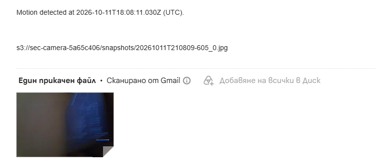

# Security Camera

My motion-detecting security camera. It watches my webcam with OpenCV, and when something moves it takes a picture, uploads it to AWS and emails me the photo.

I made it to get some hands-on practice with AWS and Terraform.



## How it works


- `capture.py` compares frames from the webcam to spot motion
- when motion starts it saves a snapshot, then another one 0.3s later (the first one is often blurry)
- `uploader.py` sends the photos to S3 from a background thread, so the camera doesn't freeze while uploading. If the internet drops it retries a few times
- only the first photo of each motion event (`*_0.jpg`) triggers an email, so I get one email per event instead of 20
- a Lambda grabs the photo from S3 and sends it through SES

The camera only has a key that can upload to the bucket, nothing else. The whole AWS side is in `infra/main.tf`.


## Setup

You need Python, a webcam, Terraform and an AWS account (with the AWS CLI set up).

**1. Deploy the AWS stuff**

```bash
cd infra
terraform init
terraform apply -var="alert_email=you@example.com"
```

This creates everything and writes `edge/.env` for you, so there's no copying keys by hand. AWS will send a verification email to your address, click the link once or SES won't send anything.

**2. Run the camera**

```bash
cd edge
pip install -r requirements.txt
python capture.py
```

Press `Esc` to quit.

**3. Delete everything**

```bash
cd infra
terraform destroy
```

## Settings

At the top of `edge/capture.py`:

- `MIN_CONTOUR_AREA` - how big a moving thing has to be to count as motion
- `SNAPSHOT_COOLDOWN` - seconds between photos during one event
- `EVENT_QUIET_PERIOD` - seconds of no motion before the next event (and next email) can start
- `MAX_SNAPSHOTS_PER_EVENT` - max photos per event so it can't spam S3

## Made with

Python, OpenCV, boto3, AWS (S3, Lambda, SES, IAM), Terraform